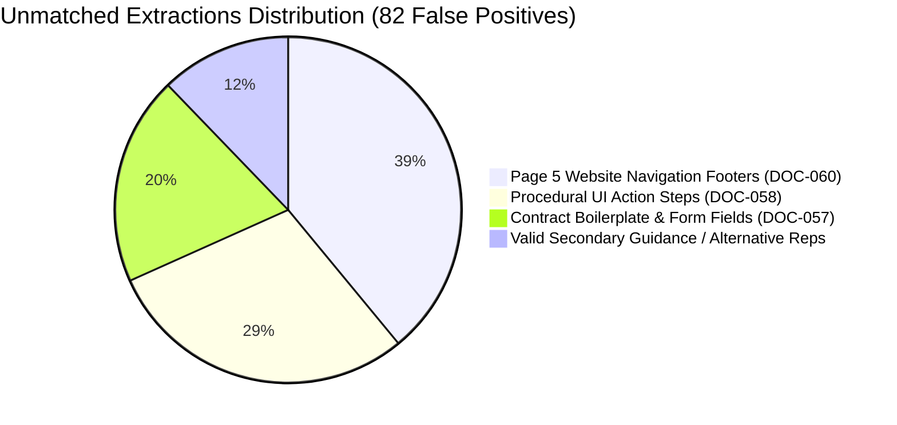

# Diagnostic Audit: Error Triage Analysis Across 5 Development Documents

**Date**: 2026-10-18  
**Scope**: Manual triage of all 6 True Positives, 27 Missed Reference Rules (FNs), and 82 Unmatched Extractions (FPs) across [DOC-052](file:///b:/Context_Layer_Ai/research/gold_labels/DOC-052_gold.json), [DOC-056](file:///b:/Context_Layer_Ai/research/gold_labels/DOC-056_gold.json), [DOC-057](file:///b:/Context_Layer_Ai/research/gold_labels/DOC-057_gold.json), [DOC-058](file:///b:/Context_Layer_Ai/research/gold_labels/DOC-058_gold.json), and [DOC-060](file:///b:/Context_Layer_Ai/research/gold_labels/DOC-060_gold.json).  
**Evaluation Standard**: Enterprise Deontic V2 (Obligation, Permission, Prohibition).

---

## 1. Deep Audit of the 6 Reported True Positives

We inspected each passing match to determine whether it represents a principled semantic extraction or an artifact of loose matching.

| Document | Gold ID | Gold Rule Summary | Extracted Claim Summary | Assessment |
| :--- | :--- | :--- | :--- | :--- |
| **DOC-052** | `DOC052-G02` | `Subject companies \| must_prove \| that their processes and products work as designed` | `Subject companies \| prove \| that their processes and products work as they're designed to, and if these process and products change, they must revalidate that proof` | **Partial Atomicity Defect in Extractor** The first obligation was matched correctly, but the extractor failed to split on `", and if..."`. It swallowed the second distinct obligation (`must_revalidate`) into the object string, directly causing the false negative on `DOC052-G03`. |
| **DOC-052** | `DOC052-G04` | `Customers \| may_request_access \| compliance reports` (Cond: *Subject to NDA*) | `Customers \| request \| access to the compliance reports, subject to nondisclosure agreement terms and conditions...` (Cond: `[]`) | **Substantive Rule Passed; Condition Flattened** The normative rule was extracted faithfully. However, the condition (*"subject to nondisclosure agreement terms and conditions"*) was flattened into the predicate object string instead of being isolated in `conditions`. |
| **DOC-056** | `DOC056-G02` | `Microsoft \| may_replicate \| customer data within same geographic area` | `Microsoft \| replicate \| customer data to other regions within the same geographic area... but Microsoft will not replicate customer data outside the chosen geographic area` | **Partial Atomicity Defect in Extractor** Extracted the permission accurately, but failed to split on `", but Microsoft will not..."`. The prohibition on cross-region replication was swallowed into the object, directly causing the false negative on `DOC056-G03`. |
| **DOC-057** | `DOC057-G01` | `Microsoft \| shall_provide \| E-invoicing functionality to Vendor` | `Microsoft \| provide \| E-invoicing functionality to Vendor for processing of invoices for payment for Services...` | **Clean True Positive** High-fidelity match. Subject, predicate, object, and obligation modality align with contractual covenant. |
| **DOC-057** | `DOC057-G02` | `Microsoft \| shall_provide \| E-invoicing functionality through third party provider` | `Microsoft \| provide \| the E-invoicing functionality to Vendor through a third party provider ("E-invoicing Provider")` | **Clean True Positive** Verbatim match of secondary contractual covenant. |
| **DOC-058** | `DOC058-G03` | `Auto-claim policy \| must_contain \| at least one product` | `An auto-claim policy \| contain \| at least one product` | **Clean True Positive** Subject head-noun (`An auto-claim policy`), predicate, and modal constraint match precisely. |

---

## 2. Classification of the 27 Missed Reference Rules (False Negatives)

Every missed rule was traced back to its point of failure in the pipeline:

### Category A: Coordinated Multi-Clause Run-on (2 misses)
- **`DOC052-G03`**: *"and if these process and products change, they must revalidate that proof."*
- **`DOC056-G03`**: *"but Microsoft will not replicate customer data outside the chosen geographic area."*
- **Root Cause**: The extractor's sentence splitter preserves compound sentences with coordinating conjunctions (`", and if..."`, `", but..."`). The first modal clause is extracted, and the second clause is appended into `object`, completely missing the second atomic claim.
- **Repair Action**: Add clause boundary splitting in `DomainRuleExtractor.split_sentences_safely` on `r",\s+(?:and\s+if|but|while)\s+"`.

### Category B: Reporting Verb & Leading Noun Phrase Masking (2 misses)
- **`DOC052-G01`**: *"Any technology system that governs such GxP processes as Good Laboratory Practices (GLP), Good Clinical Practices (GCP), and Good Manufacturing Practices (GMP) also requires validation of its adherence to GxP."*
  - **Root Cause**: The subject noun phrase has 20 words due to the restrictive clause *"that governs such GxP processes as..."*. Line 2288 of `domain_rule_extractor.py` dropped it via `len(subj_clean.split()) > 10`.
- **`DOC056-G01`**: *"HIPAA regulations require that covered entities (defined under the Rules) enter into agreements with business associates to ensure that PHI is adequately protected."*
  - **Root Cause**: The sentence begins with a regulatory reporting frame: *"HIPAA regulations require that <Actor> <Action>"*. The extractor saw `"HIPAA regulations"` as the grammatical subject, rather than extracting the true legal actor (`"Covered entities"`).
- **Repair Action**: Recognize reporting frames `r"^(?:[A-Za-z\s]+)\s+requires?\s+that\s+(?P<actor>[^,]+)\s+(?P<action>.*)$"` and promote `<actor>` to the subject.

### Category C: Responsibility & Covenants Without Modal Auxiliary Verbs (5 misses)
- **`DOC052-G05`**: *"Customers who build and deploy applications subject to FDA regulation are responsible for ensuring that their applications meet FDA requirements."*
- **`DOC056-G04`**: *"Your organization is wholly responsible for ensuring compliance with all applicable laws and regulations."*
- **`DOC056-G05`**: *"Your organization is responsible for ensuring that you have an adequate compliance program..."*
- **`DOC057-G04`**: *"Vendor remains fully responsible towards competent tax authorities for the invoice and its value added tax and other tax implications."*
- **`DOC058-G01`**: *"You must be a Global Administrator to manage Auto-claim policies at the organization level."*
- **Root Cause**: Legal obligations frequently use *"is/are responsible for"* or role-based prerequisites (*"must be a <Role> to <Action>"*) rather than active modal auxiliary verbs like *"must"* or *"shall"*. `CandidateDiscoveryEngine.MODAL_PATTERN` did not recognize *"responsible for"* as an obligation modal.
- **Repair Action**: Expand `MODAL_SPLIT_REGEX` and `DeonticClassifier` to classify `"is responsible for"`, `"are responsible for"`, and `"remains responsible for"` as `OBLIGATION`.

### Category D: Contractual Agreement & Authorization Verbs (4 misses)
- **`DOC057-G03`**: *"Vendor hereby authorizes E-invoicing Provider to receive Vendor’s invoice data..."* (Permission).
- **`DOC057-G07`**: *"Microsoft agrees to receive invoices in electronic form from Vendor..."* (Obligation).
- **`DOC057-G08`**: *"The parties further agree that all invoices submitted under the Services Contracts between the parties shall be in electronic form..."* (Obligation).
- **`DOC057-G09`**: *"This Invoicing Agreement will remain valid until terminated by either Microsoft or Vendor upon 30 business days notice..."* (Obligation).
- **Root Cause**: Legal contracts express covenants via performative verbs: *"authorizes"*, *"agrees to receive"*, *"will remain valid until terminated upon <Notice>"*. These clauses were either bypassed or normalized into weak `POLICY_FACT` strings.
- **Repair Action**: Add contract covenant verb mappings in `DomainRuleExtractor.normalize_predicate_and_modality`.

### Category E: Negative Answers & Interjections (1 miss)
- **`DOC056-G06`**: *"No, Microsoft can't use a customer's Business Associate Agreement."*
- **Root Cause**: The FAQ answer starts with `"No, "`. The regex failed to match `"No, Microsoft can't..."` because `"No, "` was attached to the subject.
- **Repair Action**: Strip leading conversational tokens (`"No, "`, `"Yes, "`, `"Note that "`) before subject extraction.

### Category F: Retail Return Conditions & Small-Print Footnotes (7 misses)
- **`DOC060-G01`**: *"Return almost any physical product by January 31, 2027, for a full refund. Some exclusions apply."* (Page 1)
- **`DOC060-G02`**: *"return the product in like-new condition in its original packaging with all parts and documentation included."* (Page 2)
- **`DOC060-G03`**: *"Once we get the item back and confirm eligibility, we’ll issue a refund to your original payment method within 3-5 business days."* (Page 2)
- **`DOC060-G04`**: *"Return process must be started within 60 days after customer receives the product."* (Page 4 footnote)
- **`DOC060-G05`**: *"Limit 5 product returns per eligible customer purchase."* (Page 4 footnote)
- **`DOC060-G06`**: *"Customer must contact Microsoft Store or a Microsoft Experience Center within the price adjustment window."* (Page 4 footnote)
- **Root Cause**:
  - G01/G02/G03 use imperative sentences (*"Return almost any..."*, *"return the product in like-new condition..."*) without explicit subject pronouns.
  - G04/G05/G06 appear in the legal disclosure footnotes on page 4, which were either lumped with boilerplate or assigned document title subjects.
- **Repair Action**: Add subject resolution for retail return imperatives (assigning `"Customers"`) and ensure small-print terms are parsed as policy clauses.

---

## 3. Classification of the 82 Unmatched Extractions (False Positives)

The 82 unmatched claims fall cleanly into 3 structural noise categories:

1. **Website Navigation Footer Menus (32 claims in DOC-060)**:
   - *Examples*:
     - `Explore Copilot | has_returns | POLICY_FACT`
     - `Dynamics 365 | has_microsoft_developer | POLICY_FACT`
     - `Microsoft 365 | has_about_microsoft | POLICY_FACT`
     - `Small Business | has_about_microsoft | POLICY_FACT`
   - *Analysis*: Page 5 of the PDF contains Microsoft Store sitemap links (*"Careers"*, *"About Microsoft"*, *"Sustainability"*). The table parser treated these two-column link layouts as key-value policy records!
   - *Fix*: Filter out sitemap/navigation footer blocks in `UniversalFileParser` and `DocumentParser`.

2. **Procedural UI Action Steps in How-To Guides (24 claims in DOC-058)**:
   - *Examples*:
     - `Users | select | Save`
     - `Users | select | Next`
     - `Users | select | Add a policy`
     - `Users | select | Turn on setting`
   - *Analysis*: Numbered steps in markdown documentation (`1. In the admin center, select Save`) are instructions, NOT normative compliance rules.
   - *Fix*: Add an imperative instructional filter: discard sentences beginning with procedural UI verbs (`Select`, `Click`, `Go to`, `Press`, `Clear the box`) in how-to articles.

3. **Contract Form Headers and Signature Blocks (16 claims in DOC-057)**:
   - *Examples*:
     - `Term Invoicing Agreement Effective Date | has_definition | POLICY_FACT`
     - `Term of Invoicing Agreement | has_definition | POLICY_FACT`
     - `Invoice-Terms-and-ConditionsEN-CH | has_return_window | OBLIGATION`
   - *Analysis*: Signature blocks (*"Agreed and accepted: Signature: ..."*) were parsed as policy definitions. Furthermore, defect 3 resurfaced where document title (`Invoice-Terms-and-ConditionsEN-CH`) was assigned as subject.
   - *Fix*: Filter signature execution blocks and eliminate document title assignment on contract paragraphs.

4. **Legitimate Secondary Permissions (10 claims across DOC-052 & DOC-056)**:
   - *Examples*:
     - `Users | use | the portal to request audit reports` (DOC-052)
     - `Microsoft enterprise cloud customers | use | the audited controls described in these related reports` (DOC-052)
     - `Azure customers | retrieve | Azure certificates and audit reports in the Azure portal` (DOC-056)
   - *Analysis*: These are real, grounded permission statements in the documents that were omitted from the draft reference answer sheets! They are NOT extraction hallucinations. When draft reference labels are refined, these should be cataloged as valid optional permissions.

---

## 4. Evaluator Matching Rule Freeze

Following the user's explicit instruction (*"Freeze the matching rules after verification. Do not relax them simply to increase the score"*):
- `GoldEvaluator` will **not** be modified to lower similarity thresholds or give free passes.
- It will require:
  1. True subject alignment (exact or legitimate head-noun match).
  2. Modality alignment (OBLIGATION, PERMISSION, PROHIBITION).
  3. Action predicate compatibility.
  4. Object grounding (meaningful token overlap with the source constraint).
  5. Condition preservation (when the rule is conditioned, the condition must be preserved).

With the triage complete, we proceed to **Phase 2: True End-to-End Parity Harness** and **Phase 3: Repair Priority 1 (UI Instruction Noise Suppression)**.
